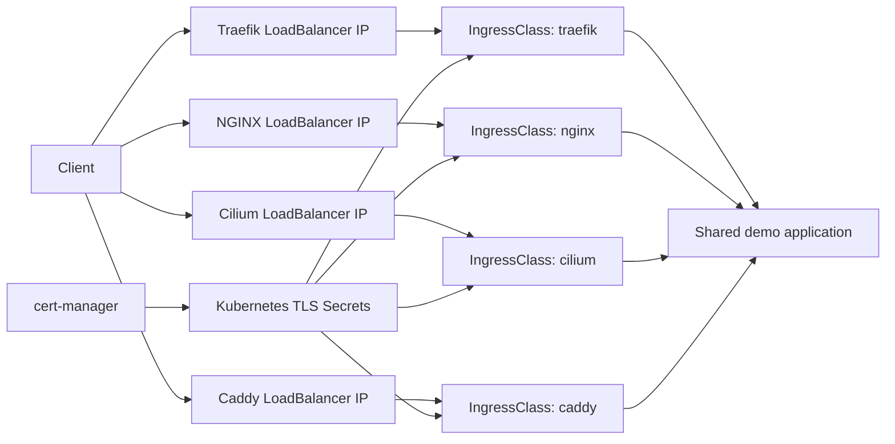

# Project 03 - Kubernetes Ingress Controller Comparison

**Status:** Planning  
**Focus:** Operate, compare, validate, and cleanly remove four Kubernetes ingress controllers in one K3s lab.

## Why one comparison project

This cluster uses Cilium LoadBalancer IPAM. Each ingress controller Service can therefore receive a distinct LoadBalancer IP address from the configured pool. The controllers can all expose HTTP (`80`) and HTTPS (`443`) simultaneously because those ports are bound to different IP addresses.

That makes a side-by-side, evidence-based comparison more valuable than four isolated installations. The project will still keep every controller's Helm values, manifests, validation output, and teardown procedure in its own folder.

## Controllers in scope

| Controller | IngressClass | Exposure | What the comparison demonstrates |
| --- | --- | --- | --- |
| Traefik | `traefik` | Dedicated LoadBalancer IP | Lightweight Kubernetes-native routing and middleware model |
| F5 NGINX Ingress Controller | `nginx` | Dedicated LoadBalancer IP | Maintained NGINX-based implementation and configuration model |
| Cilium Ingress | `cilium` | Dedicated LoadBalancer IP | Envoy-backed ingress integrated with the Cilium CNI |
| Caddy Ingress Controller | `caddy` | Dedicated LoadBalancer IP | Caddy routing model and consumption of cert-manager TLS Secrets |

`cert-manager` is included for certificate lifecycle automation. It is not an ingress controller.

## Target architecture



## Safety and design rules

- Every route specifies `spec.ingressClassName`; no controller is made the cluster default.
- Every controller Service receives a separate LoadBalancer IP from Cilium LB IPAM.
- Every controller Service carries `homelab.io/lb: "true"` and uses `loadBalancerClass: io.cilium/l2-announcer`; see [the Service contract](docs/cilium-loadbalancer-service-contract.md).
- The IP pool must have capacity for all required controller Services and their companion Services, if any.
- External L2/BGP advertisement and firewall/NAT paths must make each allocated IP reachable before public testing.
- cert-manager is the only certificate lifecycle owner. Caddy consumes TLS Secrets; its separate automatic ACME lifecycle is not used for this comparison.
- Each controller has explicit resource requests and limits. Dashboards and optional features remain disabled unless being demonstrated.
- Evidence replaces all actual IP addresses with `172.16.0.0/24`.

## Repository layout

```text
.
├── controllers/
│   ├── traefik/       # Helm values, manifests, tests, evidence
│   ├── nginx/         # F5 NGINX Ingress Controller materials
│   ├── cilium/        # Cilium ingress enablement and tests
│   └── caddy/         # Caddy ingress controller materials
├── certificates/
│   └── cert-manager/  # issuer and certificate automation
└── docs/              # shared architecture and comparison decision records
```

## Definition of done

- All four controller Services receive different LoadBalancer IPs and report Ready.
- The same demo app is reachable through a route explicitly assigned to each IngressClass.
- A routing, readiness, and resource-footprint comparison is committed with addresses redacted.
- cert-manager successfully creates a TLS Secret and one controller consumes it.
- Each controller has a documented uninstall procedure and post-teardown verification.

## What I can explain in an interview

- Why port `80/443` can be reused safely across different LoadBalancer IP addresses.
- The distinction between a LoadBalancer Service, an IngressClass, and an Ingress resource.
- How Cilium LB IPAM allocation and external advertisement affect reachability.
- Why one default controller is avoided in a multi-controller cluster.
- The operational trade-offs among Traefik, F5 NGINX, Cilium/Envoy, and Caddy.
